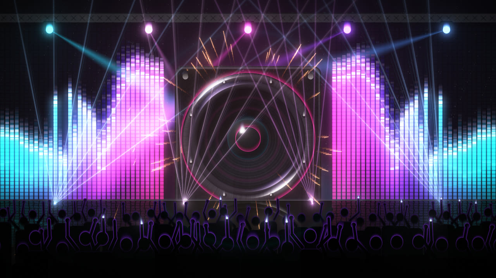
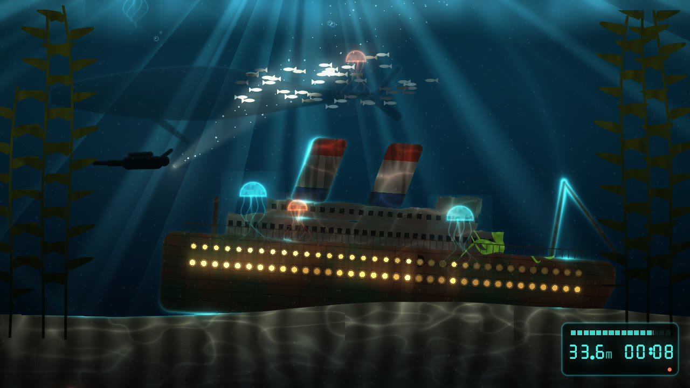
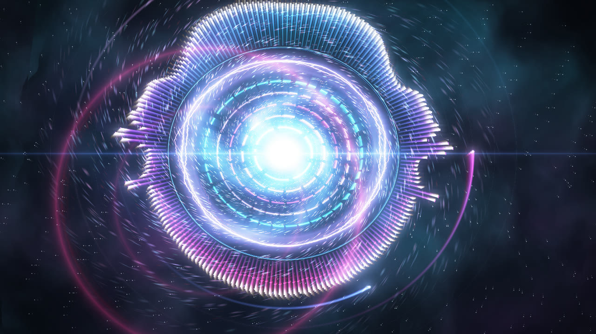
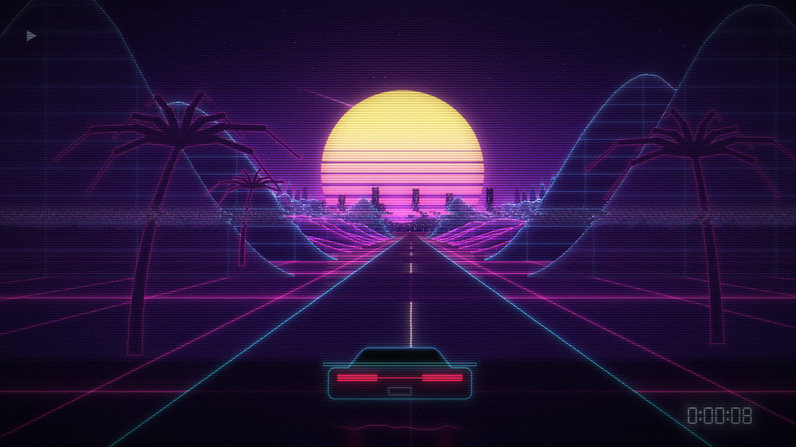
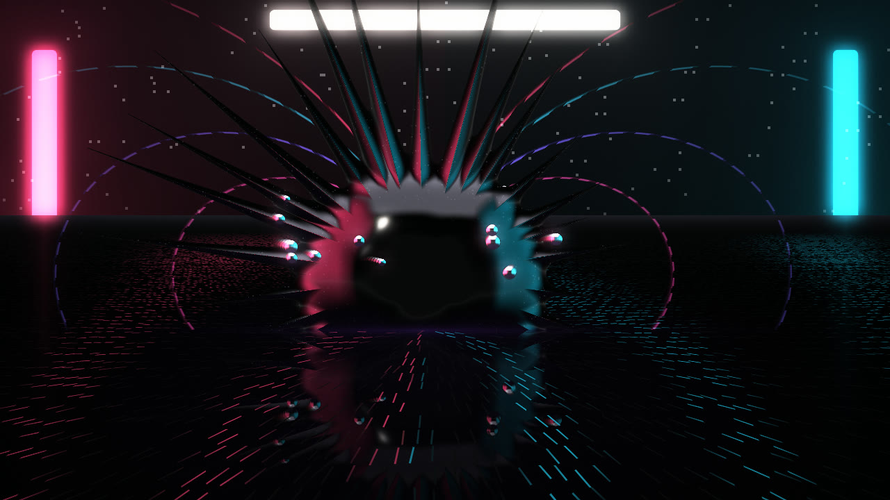
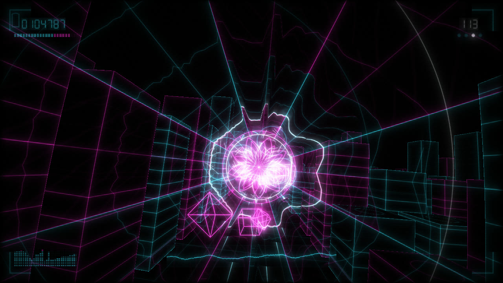
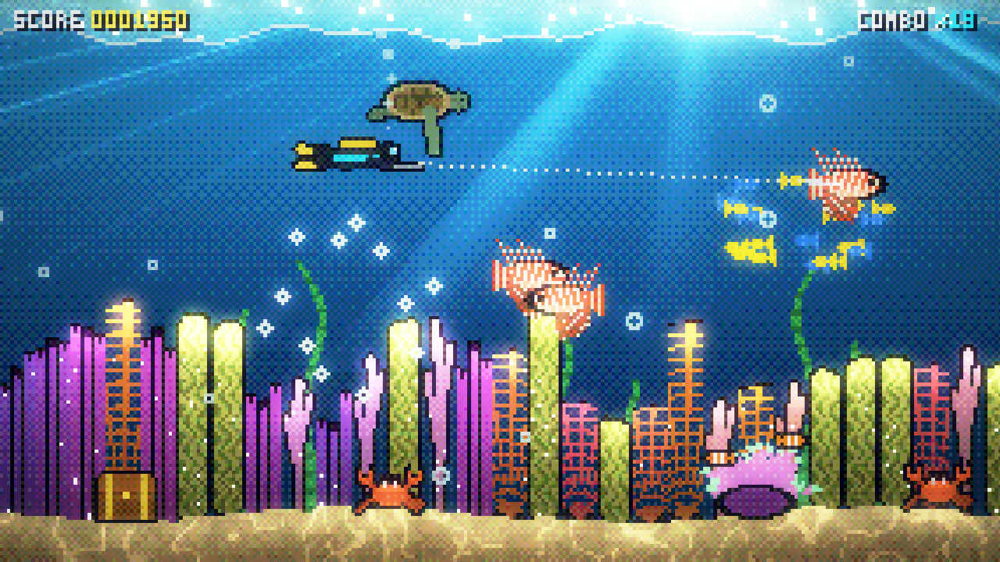
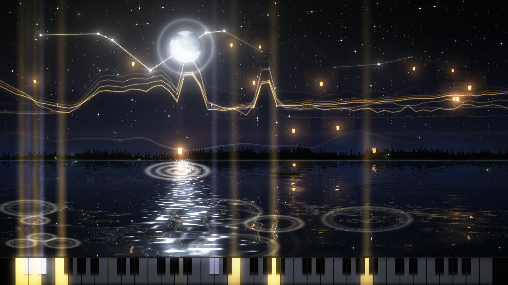
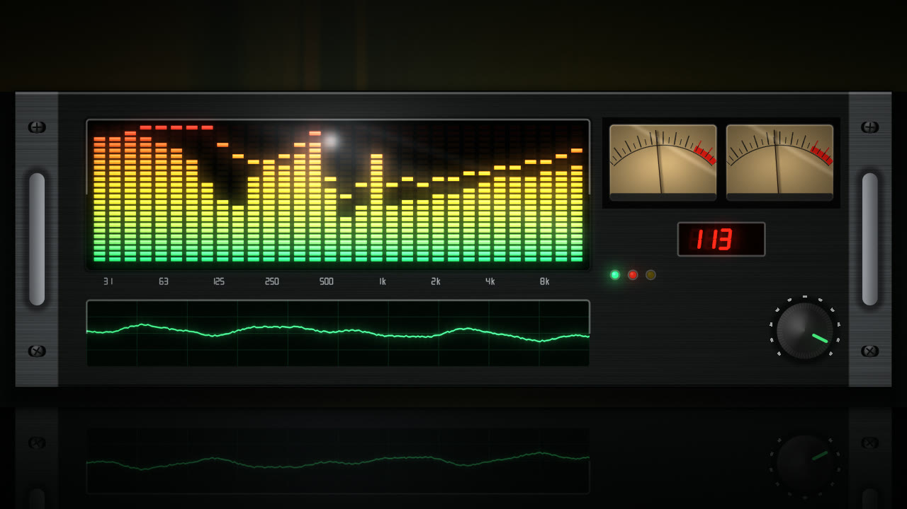

<div align="center">

# Music Visualizer

**Ten hand-built GPU worlds that react to every part of whatever you're playing.**

Windows tray app in Rust + wgpu · the same WGSL shaders in the browser and a Chrome extension (WebGPU)

[**▶ Try it in your browser**](https://curiocrafter.github.io/music-visualizer/app/visualizer.html?mode=demo) ·
[**Download for Windows**](https://github.com/CurioCrafter/music-visualizer/releases/latest/download/MusicVisualizer.exe) ·
[**Website**](https://curiocrafter.github.io/music-visualizer/)

 
 

</div>

## What makes it different

Most visualizers make things bigger when the music gets louder. This one splits the music into separate signals and
gives each one its own job in every scene:

- **Kick, snare and hi-hat** each have their own onset detector, so the snare can flash the lights while the kick punches the camera.
- **Tempo and beat phase**: a tempo tracker knows where you are inside each beat, so motion lands on the beat.
- **The drop**: it detects the bass slamming back after a break-down and fires shockwaves, strobes and boss fights.
- **Piano notes**: an 8192-point FFT picks out the 88 keys, and the moonlit keyboard plays along.
- **Section energy and brightness** (quiet verse vs. big chorus, dark sub vs. airy treble) set how much of the scene is lit and its colour temperature.
- **Spectrum history and the raw waveform** build mountains, echoes and oscilloscope rings.
- **Mouse control**: steer the tunnel, aim the diver's torch, move the moon. Clicks make ripples, pings and bursts.
- **Album-art colours**: it reads what's playing (Spotify, YouTube, ...) and recolours the look to match the cover.

## The looks

| | |
|---|---|
|  **Bass Drop**: a club with a pumping woofer, lasers through haze and a crowd that jumps on the beat |  **Ferrofluid**: magnetic liquid on a mirror floor, spiking to the spectrum |
|  **Data Bus**: a neon line-art tunnel; viruses get deleted on the kick and a worm lunges on the drop |  **Pulse Ring**: a reactor of rings, a live waveform ring, a vortex and shockwaves |
|  **Neon Horizon**: synthwave with mountains built from the last seconds of music |  **Reef Arcade**: a pixel-art reef; a diver spears lionfish on the beat, with a boss on the drop |
|  **Deep Wreck**: an ocean liner on the sea floor, porthole spectrum, sonar, a whale and jellyfish |  **Moonlight Piano**: a lake and moon; the keyboard lights the notes being played |
|  **Aurora**: northern lights over a mirror lake; a wolf howls on the drop |  **Classic Bars**: a hi-fi rack with LED analyser, VU meters and a scope |

## Windows app

Download `MusicVisualizer.exe` from [Releases](https://github.com/CurioCrafter/music-visualizer/releases/latest)
and run it. It's a single 5 MB file with no installer. Windows SmartScreen may warn because the exe isn't
code-signed: choose *More info → Run anyway*, or build it yourself.

- It lives in the tray: click the icon to show or hide it. Right-click for the menu.
- Drag it anywhere (it snaps to edges and corners) and drag an edge to resize. Double-click or press `F` for full screen.
- Frosted glass buttons give you previous/next look, mouse control, settings, full screen and hide.
- Keys and mouse:
  - Wheel or arrow keys: change look
  - `S`: settings
  - `M`: mouse control
  - `Esc`: back / hide
- Settings:
  - auto-pick a look for the music
  - album-art colours and song title
  - size, frame rate, quality and sensitivity
  - always on top, start with Windows
  - ghost mode (clicks pass through)

It hears whatever your PC plays through WASAPI loopback (no virtual cable). It runs at below-normal priority so games
always come first. One frame in flight keeps the latency low.

```
cargo build --release          # target\release\MusicVisualizer.exe
```

## Browser and Chrome extension

The [web player](https://curiocrafter.github.io/music-visualizer/app/visualizer.html?mode=demo) runs the same
shaders with WebGPU (Chrome/Edge). It can use a demo song, a shared tab's audio or the microphone. The Chrome extension adds
one-click capture of the current tab's audio: see [extension/README.md](extension/README.md).

## Write your own look

A look is one WGSL file: `fn look(fc: vec2f) -> vec4f`, with the music in a uniform and an audio texture.

```wgsl
// name: My Look
// palette: #ff2fa6 #8a3cff #22e0ff
fn look(fc: vec2f) -> vec4f {
    let p = centered(fc);
    let r = 0.35 + 0.25 * G.kick + 0.1 * spec(fract(atan2(p.y, p.x) / TAU));
    var col = pal(G.beat_phase) * glow(abs(length(p) - r), 0.02);
    col += vec3f(G.drop) * 0.3;
    return vec4f(col, 1.0);
}
```

Test it without opening a window: `MusicVisualizer.exe --shots out shaders/looks/my_look.wgsl` renders it with a
built-in test song and saves PNGs. The full contract is in [docs/WRITING_LOOKS.md](docs/WRITING_LOOKS.md).

## How it's built

```
src/analyzer.rs   FFT bands, kick/snare/hat onsets, tempo + beat phase, drop, energy, piano keys
src/capture.rs    WASAPI loopback capture
src/render.rs     look pass (with last-frame feedback) → bloom → composite + glass UI, wgpu / DirectX 12
src/app.rs        tray, dockable window, settings panel, mouse control, auto-pick
src/media.rs      now playing + album-art palette (Windows media controls)
shaders/          common.wgsl (the contract), post.wgsl, looks/*.wgsl
extension/        WebGPU player + Chrome extension running the same shaders
site/             the project website
```

Made by [Andrew Rainsberger](https://curiocrafter.github.io/). MIT licence.
